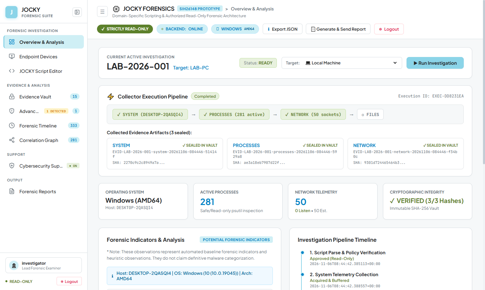
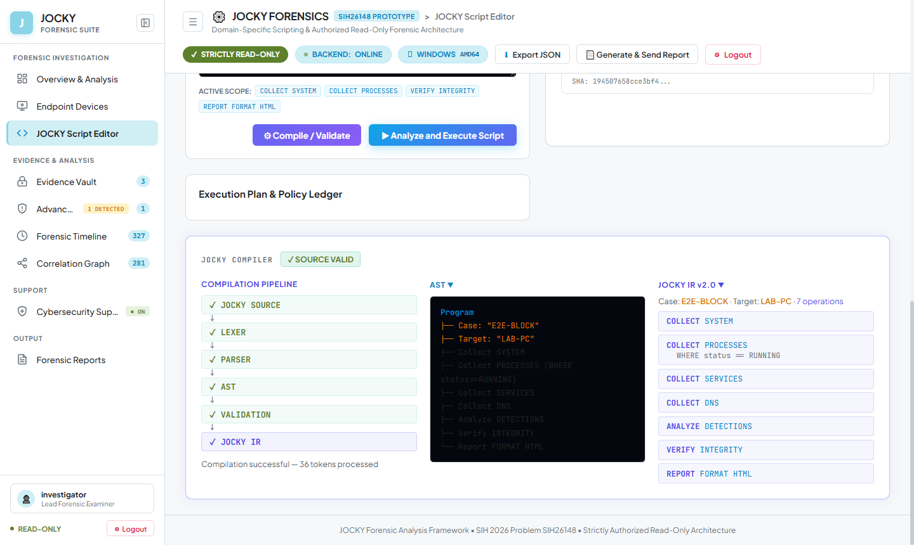
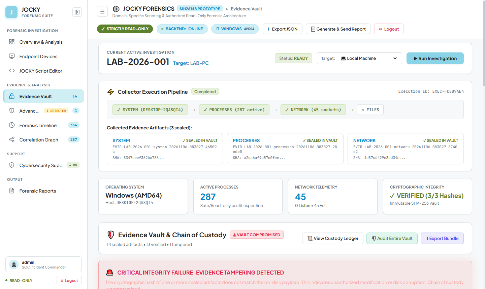
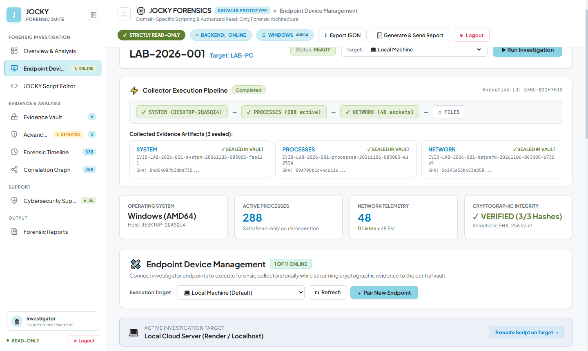
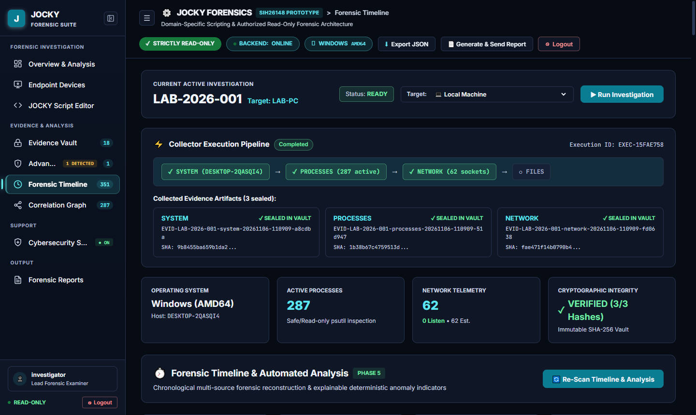
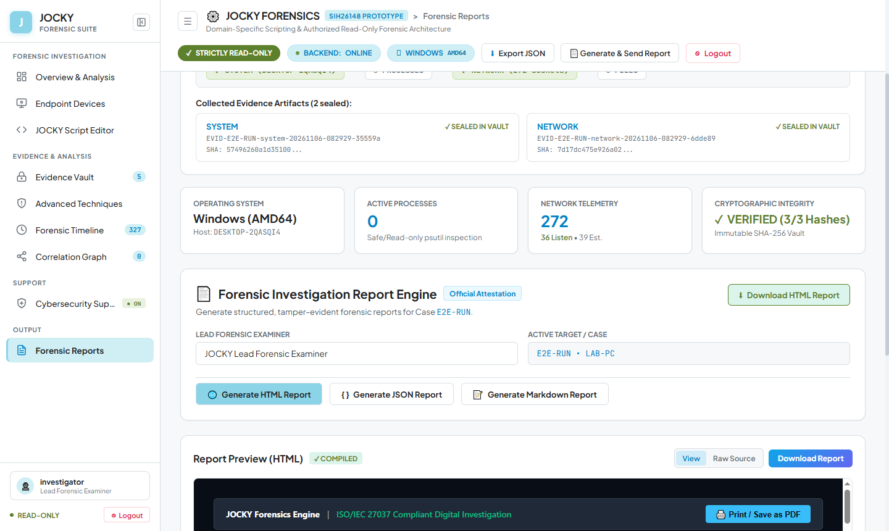
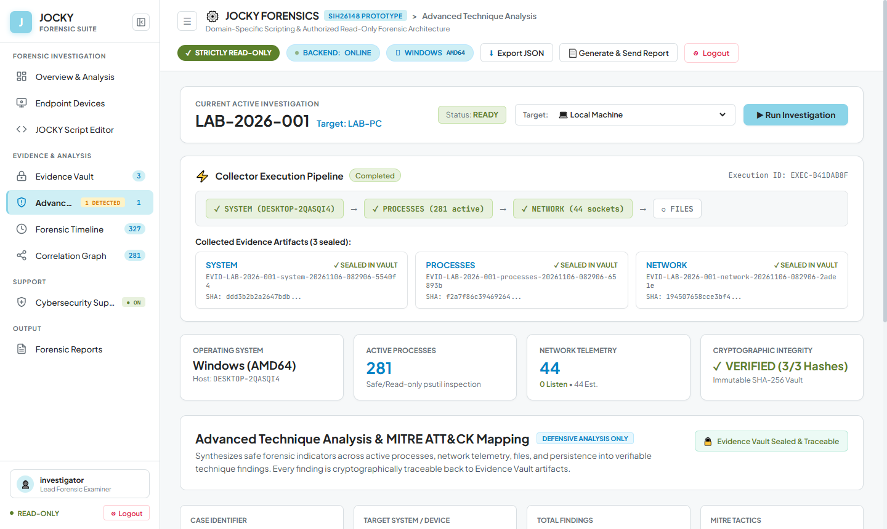
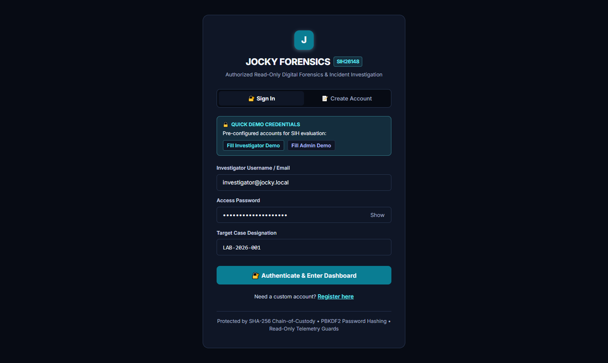
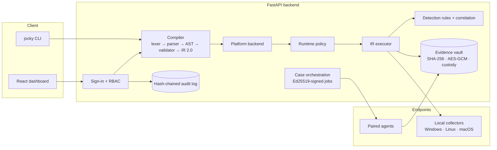

# JOCKY — A Forensic Investigation Language

**JOCKY is a small programming language for digital forensics, with a compiler, a cross-platform evidence
engine, explainable threat detection and a web dashboard to drive it all.** An investigator writes what to
collect and analyse; JOCKY compiles it, checks it against a read-only policy, runs it on Windows or Linux
(locally or on paired endpoints), seals every result as tamper-evident evidence and explains what it found.

Built for **Smart India Hackathon 2026, problem statement SIH26148**.

[](https://github.com/MuzraFatima/jocky-forensics/actions/workflows/ci.yml)
[](tests/)
[](docs/LANGUAGE.md#operation-catalog)
[](LICENSE)

**Live demo:** <https://jocky-forensic.netlify.app> · sign in with `investigator@jocky.local` / `jocky-forensics-2026`



---

## Contents

- [What JOCKY does](#what-jocky-does)
- [Screenshots](#screenshots)
- [The language](#the-language)
- [Architecture](#architecture)
- [Quickstart](#quickstart)
- [Configuration](#configuration)
- [Measured results](#measured-results)
- [Security and scope](#security-and-scope)
- [Repository layout](#repository-layout)
- [Documentation](#documentation)
- [License](#license)

## What JOCKY does

| | |
|---|---|
| **A real language** | Lexer, parser, AST, semantic validator and a typed, versioned IR. Every error has a code, a line and a "did you mean" hint. Scripts can be written as `investigation "name" { ... }` blocks or flat statements. |
| **Platform backend** | The same script is lowered for Windows, Linux or macOS; anything a platform cannot do is reported as unsupported with a reason, never silently skipped. |
| **Cross-platform evidence** | System, processes, network, files, users, services, startup entries, drivers / kernel modules, listening ports and DNS settings, all read-only, all in one result format. |
| **Explainable detection** | Declarative rules mapped to MITRE ATT&CK. Each finding says which field matched, links its evidence and lists benign explanations; independent signals are correlated but a host is never declared "compromised". |
| **Evidence you can defend** | SHA-256 sealing, chain-of-custody records, optional AES-256-GCM encryption at rest and a hash-chained audit log. |
| **Many endpoints, one case** | Paired agents receive Ed25519-signed jobs with expiry and replay protection; one case can be dispatched to several devices and followed per endpoint. |
| **Access control** | Sign-in on every forensic endpoint, with viewer / investigator / admin levels. |
| **Measured** | Compiler correctness, collection cost, detection precision / recall, tamper detection and orchestration timings are reproducible with one script ([docs/EVALUATION.md](docs/EVALUATION.md)). |

## Screenshots

| | |
|---|---|
|  |  |
| **Script editor** — the compiler pipeline, AST and IR 2.0 for a block-syntax script | **Evidence vault** — an admin's tamper test is caught on the next audit |
|  |  |
| **Endpoints** — a paired agent online and ready for signed jobs | **Correlation** — processes, executables and sockets linked into one graph |
|  |  |
| **Timeline** — collected events in order | **Reports** — HTML, JSON or Markdown, downloaded with the session token |
|  |  |
| **Advanced techniques** — indicators mapped to ATT&CK | **Sign-in** — Lighthouse 93 / 100 / 96 / 100 |

## The language

```jocky
investigation "Persistence_Sweep" {
    target "lab-ubuntu"
    platform detect

    collect running_processes where status == running
    collect services
    collect startup_entries
    collect kernel_modules
    collect listening_ports
    collect dns

    analyze detections
    verify integrity
    report format html
}
```

```console
$ python jocky.py compile examples/block_audit.jocky --platform linux
[+] Compilation SUCCESSFUL (43 tokens)
    Case ID:    System_Audit_001
    IR Version: 2.0
    Platform:   LINUX
      - line 8: COLLECT SYSTEM
      - line 9: COLLECT PROCESSES
      ...

$ python jocky.py compile broken.jocky
[-] Compilation FAILED: JKY205 JockySyntaxError
    Line 3, Column 1: Unknown command or unexpected token 'COLECT'.
    Hint: Did you mean 'COLLECT'?
```

There is deliberately no way to run a shell command, write outside the evidence store, inject into a
process, load a driver or persist. Grammar, rules, operation catalog, IR schema and error codes:
[docs/LANGUAGE.md](docs/LANGUAGE.md).

## Architecture



The seven layers of the blueprint map onto the code like this:

| Layer | Where |
|---|---|
| Management interface | `frontend/` (React + Vite) |
| Orchestration | `backend/app/agents/` (pairing, signed jobs, cases), `agent/` (endpoint agent) |
| Language engine | `backend/app/language/` |
| Execution engine | `backend/app/engine/`, `backend/app/collectors/` |
| Analysis and evidence | `backend/app/detection/`, `backend/app/analysis/`, `backend/app/evidence/` |
| Storage and reporting | `backend/app/evidence/vault.py`, `backend/app/reporting/` |
| Security and governance | `backend/app/security/` (auth, RBAC, audit chain) |

## Quickstart

Requirements: Python 3.10+ and Node.js 20+.

```bash
git clone https://github.com/MuzraFatima/jocky-forensics.git
cd jocky-forensics

# backend
pip install -r backend/requirements.txt
python jocky.py serve                       # http://127.0.0.1:8000  (API docs at /docs)

# frontend, in a second terminal
cd frontend
npm install
npm run dev                                 # http://localhost:5173
```

Sign in with `investigator@jocky.local` / `jocky-forensics-2026` (investigator) or
`admin@jocky.local` / `admin-forensics-2026` (admin). The dashboard runs a first investigation of the
local machine as soon as you sign in.

**Command line**

```bash
python jocky.py compile examples/block_audit.jocky --emit ir     # print the IR
python jocky.py execute examples/sample.jocky --format HTML -o report.html
python jocky.py audit                                            # verify every sealed artifact
```

**Pair another machine** — on the dashboard open *Endpoint Devices → Pair New Endpoint*, then on the
endpoint:

```bash
python jocky-agent.py pair --server http://<server>:8000 --code <8-character code>
python jocky-agent.py start
```

**Tests and lint**

```bash
pip install -r backend/requirements-dev.txt
python -m pytest -q          # 540 tests
ruff check .
cd frontend && npm run lint && npm run build
python scripts/run_experiments.py   # regenerates docs/EVALUATION.md
```

CI runs all of this on Ubuntu (Python 3.11 and 3.12) and Windows for every push and pull request.

## Configuration

| Variable | Purpose |
|---|---|
| `JOCKY_EVIDENCE_KEY` | Base64 of 32 random bytes: encrypt evidence at rest with AES-256-GCM |
| `JOCKY_ENCRYPT_EVIDENCE=1` | Generate an evidence key once in `data/evidence.key` instead |
| `JOCKY_JOB_SIGNING_KEY` | Base64 Ed25519 seed for signing endpoint jobs (otherwise generated in `data/job-signing.key`) |
| `JOCKY_STORAGE_DIR` | Where users, devices, keys and the audit log live (default `data/`) |
| `JOCKY_EVIDENCE_DIR` | Where sealed evidence lives (default `evidence/`) |
| `JOCKY_AUDIT_LOG` | Audit log path, or `off` |
| `JOCKY_LIVE_CACHE_SECONDS` | How long live dashboard views share one collection (default 15) |
| `JOCKY_DEMO_USER` / `JOCKY_DEMO_PASSWORD`, `JOCKY_ADMIN_USER` / `JOCKY_ADMIN_PASSWORD` | Demo accounts |
| `CORS_ORIGINS` | Extra allowed frontend origins |
| `VITE_API_BASE_URL` | Frontend: backend URL for a separate deployment |

Keys, the audit log and runtime evidence are git-ignored. Back up the evidence key: encrypted evidence
cannot be read without it.

## Measured results

From [docs/EVALUATION.md](docs/EVALUATION.md), produced by `scripts/run_experiments.py` on a Windows 10
lab machine and a hand-labelled dataset. They describe the prototype under those conditions, not
real-world detection rates.

| Experiment | Result |
|---|---|
| E1 Compiler correctness | 37 / 37 valid scripts accepted; 22 / 22 invalid scripts rejected with the expected error code; identical IR across platforms |
| E2 Cross-platform | Full suite passes on Ubuntu and Windows in CI |
| E3 Collection cost | Most collectors finish in under 0.5 s; processes about 2 s on Windows |
| E4 Detection | 59 labelled records: precision 0.75, recall 0.84, F1 0.79, false-positive rate 0.21, every miss listed |
| E5 Evidence integrity | AES-GCM storage caught 5 / 5 attack types in every trial; plain SHA-256 misses hash recomputation and custody edits |
| E6 Orchestration | Signed jobs completed on 1, 3 and 5 endpoints; median dispatch-to-evidence 0.4 s, 0.8 s and 1.1 s in-process |

## Security and scope

JOCKY investigates adversary behaviour; it does not implement it. It has no process injection, no API
unhooking, no driver exploitation, no EDR or antivirus evasion, no covert channels and no arbitrary command
execution. Every collector is read-only, the runtime policy re-checks each operation before it runs, and
endpoints only execute jobs the server signed. Use it only on systems you are authorised to examine.
Details: [docs/SECURITY.md](docs/SECURITY.md).

## Repository layout

```
backend/app/
  language/      lexer, parser, AST, validator, IR builder, capability catalog, platform backend
  engine/        IR executor, runtime policy, collector providers, input hardening
  collectors/    platform collectors, host inventory, result contract, live snapshots
  detection/     JSON rules, engine, correlation, evaluation harness
  evidence/      vault, store, custody, hashing, encrypted storage
  analysis/      correlation graph, timeline, ATT&CK mapping, technique registry
  agents/        pairing, devices, signed jobs, multi-endpoint cases
  security/      auth, RBAC middleware, hash-chained audit log, incident support
  reporting/     HTML / Markdown / JSON reports
agent/           endpoint agent (pairs, verifies signed jobs, collects, uploads)
frontend/        React dashboard
examples/        sample scripts
scripts/         run_experiments.py
tests/           540 tests, fixtures and the labelled detection dataset
docs/            reference documents and screenshots
```

## Documentation

| Document | What it covers |
|---|---|
| [docs/LANGUAGE.md](docs/LANGUAGE.md) | Grammar, semantic rules, operation catalog, IR 2.0, platform backend, error codes |
| [docs/DETECTION.md](docs/DETECTION.md) | Detection rules, findings, correlation, encryption at rest, audit chain |
| [docs/SECURITY.md](docs/SECURITY.md) | Sign-in levels, signed jobs, multi-endpoint cases |
| [docs/EVALUATION.md](docs/EVALUATION.md) | Experiments E1–E6 with full tables |
| [docs/PERFORMANCE.md](docs/PERFORMANCE.md) | Performance checklist and measurements |
| [docs/ROADMAP.md](docs/ROADMAP.md) | Gap analysis against the SIH26148 blueprint and the phase plan |

## License

[MIT](LICENSE) © 2026 Muzra Fatima
